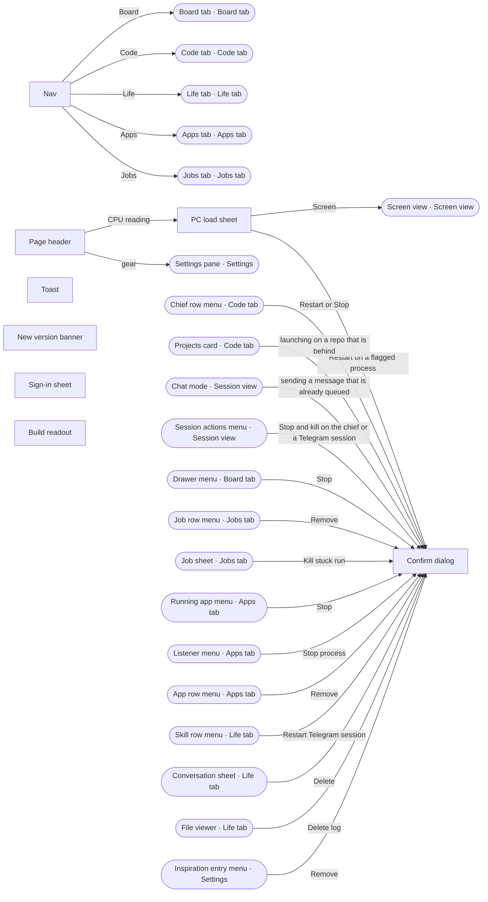
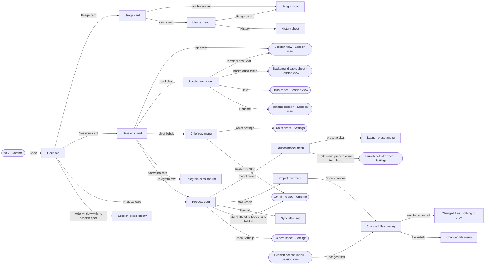
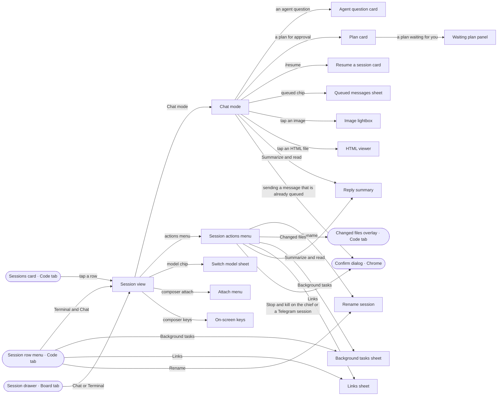
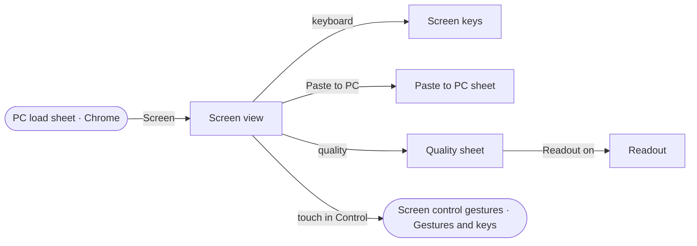
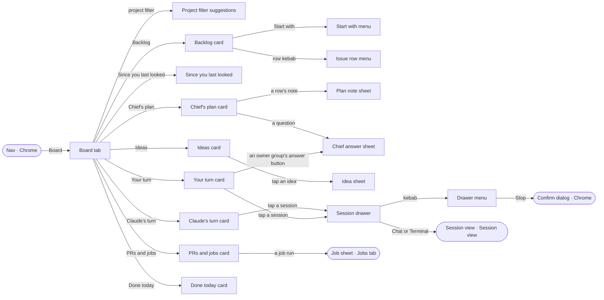
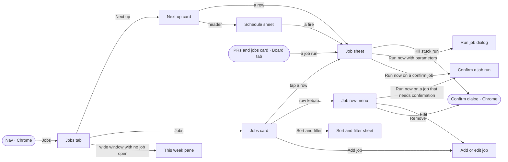
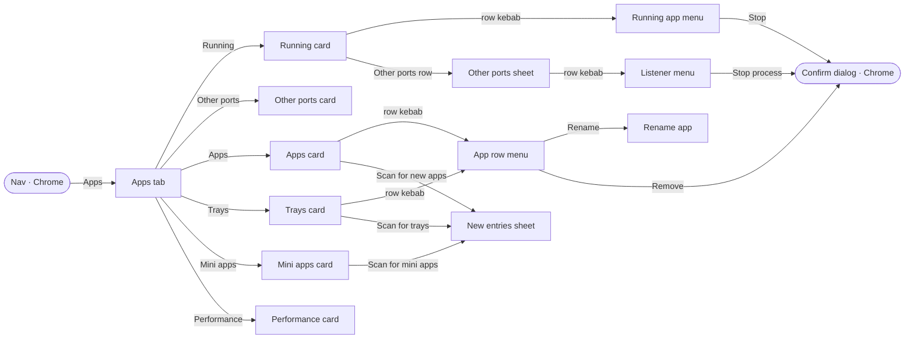
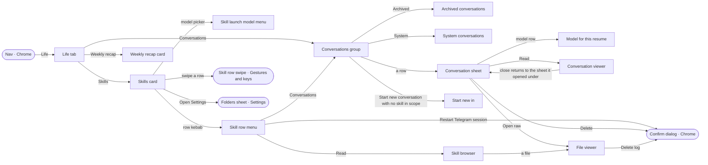
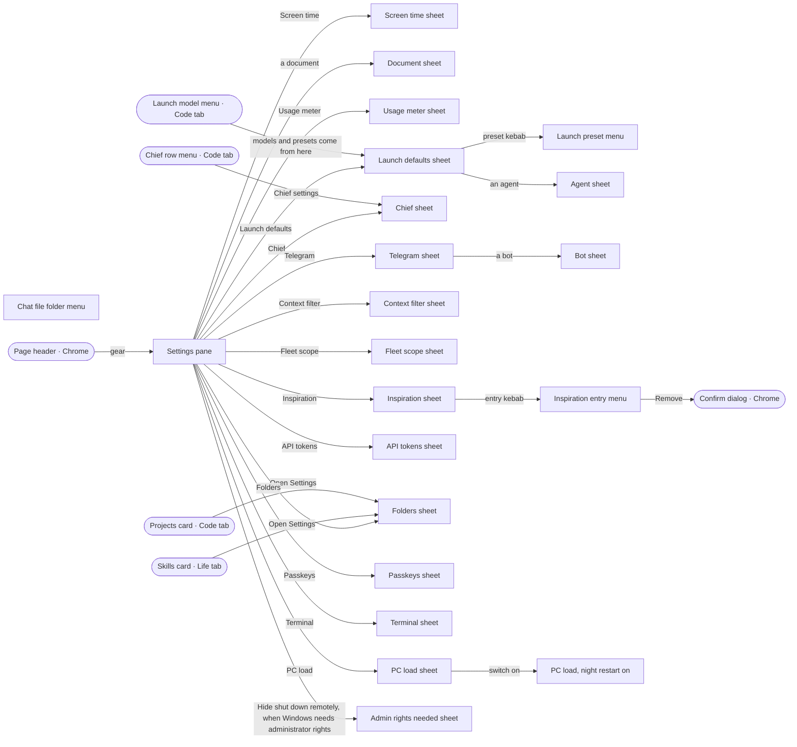
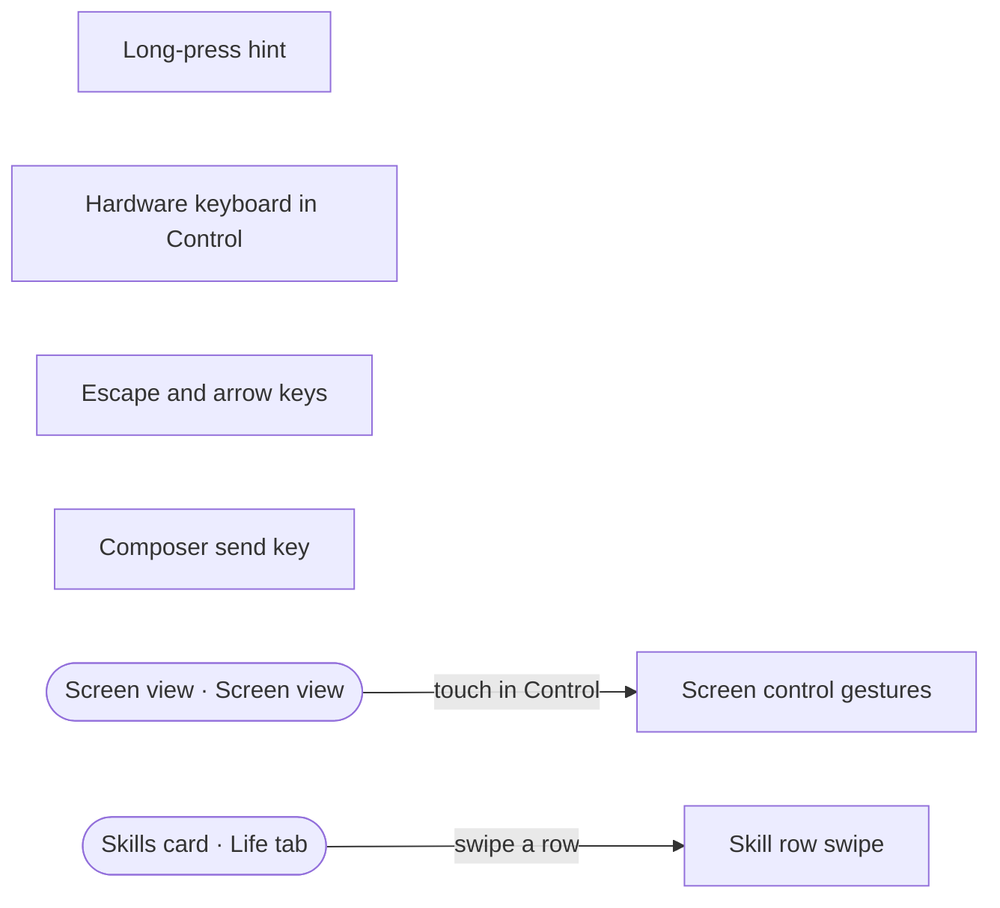

<!-- Generated from docs/ux-surfaces.yaml by scripts/ux_surface_map.py. Do not edit: change the map and re-run. -->

# UX surface map: app-launcher

Every surface a person can reach in this app, each under a stable id that its root element carries as `data-surface`. Each area has a diagram of how its surfaces connect; a rounded node is a surface in another area.

The checklist of everything a person can see and do in app-launcher: every tab, card, drill-in, menu, sheet, dialog, gesture and key, with how it is reached and what is on it.

**Keeping it true.** A change that adds, removes, renames or reshapes a user-visible surface updates its entry in this file in the same PR, adds or removes the matching `data-surface` attribute, and regenerates the page with `python scripts/ux_surface_map.py`. `scripts/ux_surface_ratchet.py` holds the markup, the JS and this file together and fails a page that is not what the file generates.

**Ids.** `<area>.<surface>`, lowercase words joined by `.` or `-`, the same form the e2e `surface(page, "<id>")` hook takes. An id never changes when a title is reworded. The vendored row menu builds its own element, so its call sites stamp the id on what `attach` returns; the vendored sign-in sheet and update banner stamp their own fixed ids.

## Ground rules

**Five tabs, one gear.** The nav is Board · Code · Life · Apps · Jobs. Settings is the gear in every page header and is not a tab. Every tab opens with the same page header: the tab's name, one context line, the CPU reading, the theme toggle and the gear.

**Layout bands** (the same markup, three placements):

| Band | Condition | Nav | Session and job detail |
| --- | --- | --- | --- |
| Phone | touch pointer | floating bottom pill, hidden while a session view is open | full-screen overlay or sheet |
| Narrow window | a mouse below 1100px, or a touch device wider than a phone | the tab bar at the top of the 772px column | full-screen overlay or sheet |
| Wide | 1100px and up with a mouse | an 80px left rail; the Board spans everything right of it | Code and Jobs become list-and-detail: the session view or the job sheet docks beside the list, and an empty pane says so |

**Where state lives.** Layout choices that belong to one device (theme, text size, folded cards, the last model picked) live in the browser. Everything else (favorites, hidden projects, launch defaults, jobs, usage choices) is saved by the server and applies on every device.

**Gating.** A feature switched off in Settings or absent on this PC removes its rows rather than greying them: the Telegram row in Sessions needs a running Telegram session, the Voice group shows only in a Remote Desktop session, the Inspiration sheet says why it is unavailable, and a usage provider switched off leaves the Usage card.

**Sheets.** Every sheet is a native `<dialog>` with a header close (✕) and one full-width primary action.

Walked 2026-11-18 against build `e6da4359`, at widths 390, 1280, themes light, dark.

## Areas

| Area | Surfaces |
|---|---|
| [Chrome](#chrome) | 8 |
| [Code tab](#code-tab) | 18 |
| [Session view](#session-view) | 17 |
| [Screen view](#screen-view) | 5 |
| [Board tab](#board-tab) | 17 |
| [Jobs tab](#jobs-tab) | 11 |
| [Apps tab](#apps-tab) | 13 |
| [Life tab](#life-tab) | 14 |
| [Settings](#settings) | 22 |
| [Gestures and keys](#gestures-and-keys) | 6 |

## Chrome

What every tab shares.

### `chrome.nav` Nav

- **Root:** `data-surface`
- **Reach:** always on screen except while a session view is open on a phone
- **Holds:**
  - one tab per destination in the order Board, Code, Life, Apps, Jobs, each an icon over a label
  - the Board tab carries a badge counting the questions the chief waits on you for, from every tab
- **Does:** switches the pane; the tab you leave keeps its scroll and folded cards
- **Phone:** a floating pill at the bottom edge
- **Desktop:** a left rail from 1100px, the tab bar on top below it
- **Why:** the fleet navigation contract, a floating pill on the phone and a left rail on a wide window
- **Leads to:**
  - [Board tab](#boardtab-board-tab) (Board)
  - [Code tab](#codetab-code-tab) (Code)
  - [Life tab](#lifeostab-life-tab) (Life)
  - [Apps tab](#appstab-apps-tab) (Apps)
  - [Jobs tab](#jobstab-jobs-tab) (Jobs)

### `chrome.page-head` Page header

- **Root:** none — the header card is repeated at the top of every pane's own markup, so each pane's entry carries it.
- **Holds:**
  - the tab's name and icon
  - one context line that names only the exceptions in their tone colour, in a compact form when the full one does not fit
  - the CPU reading, a muted percentage that turns amber then red, or a dash when no sample was taken
  - the theme toggle
  - the Settings gear
- **Does:**
  - the CPU reading opens the PC load sheet
  - the toggle flips light and dark and remembers it on this device
  - the gear opens Settings
- **Why:** Settings left the nav so five tabs keep readable labels; the CPU reading answers "is the PC loaded" from any tab
- **Leads to:**
  - [PC load sheet](#chromecpu-sheet-pc-load-sheet) (CPU reading)
  - [Settings pane](#settingspane-settings-pane) (gear)

### `chrome.cpu-sheet` PC load sheet

- **Root:** `data-surface`
- **Reach:**
  - the CPU reading in any page header
  - Settings › This PC › PC load is a different sheet and holds only the night restart
- **Holds:**
  - the PC's private IP address
  - total CPU and memory used
  - the three busiest groups of processes by name and cores used, an Everything else row so the rows add up, and a Restart action on a flagged process
  - a toast area for the result of a restart or a copy
- **Does:**
  - Copy on the IP row puts the address on the clipboard
  - the Screen button opens the Screen view of the PC
  - Done closes
- **States:**
  - a dash instead of a number when the server could not take a sample
  - Unknown instead of an address, with Copy disabled, when the PC's address could not be read
- **Leads to:**
  - [Screen view](#screenview-screen-view) (Screen)
  - [Confirm dialog](#chromeconfirm-confirm-dialog) (Restart on a flagged process)

### `chrome.confirm` Confirm dialog

- **Root:** `data-surface`
- **Reach:**
  - a destructive or sensitive action asks through it: removing an app, a job, a passkey or an inspiration entry, stopping a running app or a listener, killing a stuck run, deleting a conversation or a log, restarting a process, a bot or the chief, running a job that requires confirmation, pulling before launching on a repo that is behind, sending a message that is already queued
  - stopping an ordinary session does not ask; only the chief and a Telegram session do
- **Holds:**
  - a title and message worded for the action
  - an optional text field when the action needs a typed phrase
  - one full-width confirm button
- **Does:** the header close cancels
- **Why:** one dialog for every confirmation so the wording and the buttons never drift

### `chrome.toast` Toast

- **Root:** `data-surface`
- **Reach:**
  - any action that has a result to report
  - a long-press on an icon-only control shows its title as a toast
- **Holds:** one line of text
- **Why:** it sits on the body, outside the app column, so the floating nav cannot clip it on iOS

### `app.update-banner` New version banner

- **Root:** `data-surface`
- **Reach:** appears when the server reports a build newer than the one this page booted with
- **Holds:**
  - the text New version available
  - a Reload button
  - a dismiss button
- **Does:**
  - Reload reloads the page; only a tap does it
  - a dismissed banner stays down until the server moves to yet another build

### `shared.login` Sign-in sheet

- **Root:** `data-surface`
- **Reach:** opens by itself on the first request a device makes without a valid token
- **Holds:**
  - a password field and its one-line error
  - a Sign in button
- **States:** wrong password, locked out after repeated failures, signed in
- **Why:** the fleet's vendored sign-in; the app only calls it from the HTTP layer

### `chrome.build-footer` Build readout

- **Root:** none — the page foot, one line at the end of the column outside every tab panel.
- **Holds:** the running build and when it started

## Code tab

### `code.tab` Code tab

- **Root:** `data-surface`
- **Reach:** the Code tab, the app's default landing tab
- **Holds:**
  - the page header
  - the Usage card
  - the Sessions card
  - the Projects card
- **Does:** the cards fold; the fold survives reloads on this device
- **Desktop:** on a wide window the tab is list-and-detail, a session opens in a pane beside the list
- **Why:** the tab answers three questions in order, can I launch, what is running, what can I start
- **Leads to:**
  - [Usage card](#codeusage-usage-card) (Usage card)
  - [Sessions card](#codesessions-sessions-card) (Sessions card)
  - [Projects card](#codeprojects-projects-card) (Projects card)
  - [Session detail, empty](#codedetail-empty-session-detail-empty) (wide window with no session open)

### `code.usage` Usage card

- **Root:** `data-surface`
- **Reach:** the first card of the Code tab
- **Holds:**
  - the card summary naming the pace in its tone
  - one meter per provider that is switched on, with 5 hour and weekly bars and when they reset
  - a footer saying what the context filter saved today
  - a trailing menu button
- **Does:** a tap anywhere on the meters opens the Usage sheet
- **States:**
  - reading the quota while the first sample is pending
  - the card disappears when every provider is switched off in Settings
- **Leads to:**
  - [Usage sheet](#codeusage-sheet-usage-sheet) (tap the meters)
  - [Usage menu](#codeusage-menu-usage-menu) (card menu)

### `code.usage-menu` Usage menu

- **Root:** `data-surface`
- **Reach:** the kebab on the Usage card
- **Holds:**
  - Usage details
  - History
- **Leads to:**
  - [Usage sheet](#codeusage-sheet-usage-sheet) (Usage details)
  - [History sheet](#codehistory-sheet-history-sheet) (History)

### `code.usage-sheet` Usage sheet

- **Root:** `data-surface`
- **Reach:**
  - tap the Usage meters
  - Usage menu › Usage details
- **Holds:** the per-provider quota windows and spend in full
- **Does:** Done closes

### `code.history-sheet` History sheet

- **Root:** `data-surface`
- **Reach:** Usage menu › History
- **Holds:**
  - Day, Week and Month buckets
  - 30 days, 90 days, 6 months and Custom ranges, with From and To day fields for Custom
  - tiles and charts for lines of code, PRs merged, issues and tokens, with an In and Out switch on tokens
  - a per-repo table sortable by added lines, removed lines, PRs, opened and closed
  - the token split by agent and the age of each data source
  - a Refresh button and a toast while it runs
- **States:**
  - answers at once from the cache however old, then refreshes in place
  - a figure that could not be read says so instead of showing zero

### `code.sessions` Sessions card

- **Root:** `data-surface`
- **Reach:** the second card of the Code tab
- **Holds:**
  - one row per running session with the agent's avatar and an alive badge, the title and a line of folder, model, status, age and uptime
  - the chief's row, wearing a crown, with Start and Resume while it is stopped
  - a Telegram summary row that counts the hidden channel sessions
- **Does:**
  - tap a row opens that session's view
  - each row's kebab opens its menu
- **States:**
  - empty: No sessions launched from here yet, with a Show projects button
  - the Telegram row shows only while a Telegram session runs and the hide setting is on
- **Leads to:**
  - [Session view](#terminaloverlay-session-view) (tap a row)
  - [Session row menu](#codesession-menu-session-row-menu) (row kebab)
  - [Chief row menu](#codechief-menu-chief-row-menu) (chief kebab)
  - [Telegram sessions list](#codechannel-list-telegram-sessions-list) (Telegram row)
  - [Projects card](#codeprojects-projects-card) (Show projects)

### `code.session-menu` Session row menu

- **Root:** `data-surface`
- **Reach:** the kebab on a session row
- **Holds:**
  - Terminal and Chat
  - Background tasks and Links
  - Open in new window
  - Copy path
  - Rename
  - Stop, last, behind a divider
- **Does:** Stop asks the agent to quit cleanly, then force-terminates as a fallback, with no confirm for an ordinary session
- **States:** a Telegram session asks to confirm, and while Telegram sessions are hidden it cannot be stopped from here
- **Leads to:**
  - [Session view](#terminaloverlay-session-view) (Terminal and Chat)
  - [Background tasks sheet](#terminalbg-tasks-sheet-background-tasks-sheet) (Background tasks)
  - [Links sheet](#terminallinks-sheet-links-sheet) (Links)
  - [Rename session](#terminalrename-dialog-rename-session) (Rename)

### `code.chief-menu` Chief row menu

- **Root:** `data-surface`
- **Reach:** the kebab on the chief's row
- **Holds:**
  - Restart, only while the chief runs
  - Chief settings
  - the session menu's own items
- **Does:** Restart and Stop ask the confirm dialog, since the chief is the one session a mis-tap should not take down
- **Leads to:**
  - [Chief sheet](#settingschief-chief-sheet) (Chief settings)
  - [Confirm dialog](#chromeconfirm-confirm-dialog) (Restart or Stop)

### `code.channel-list` Telegram sessions list

- **Root:** `data-surface`
- **Reach:** the Telegram summary row in the Sessions card
- **Holds:** a read-only list of the running Telegram channel sessions
- **Does:** Done closes; there is no Stop or delete here by design
- **States:** empty: No Telegram sessions are running
- **Why:** stopping a channel session cuts someone's chat off, so it is never one tap

### `code.projects` Projects card

- **Root:** `data-surface`
- **Reach:** the third card of the Code tab
- **Holds:**
  - the launch toolbar: a model picker with Detached and Resume switches, a Sync all button and a Refresh git button
  - a filter field and a favorites filter
  - one row per project with a star, the agent launch button, git chips and a kebab
  - a footer with when git was last checked
- **Does:**
  - tap an agent button launches it in the project
  - the star pins a project to the top
  - Sync all fast-forwards every clean project that is only behind
- **States:**
  - empty: No projects found, with an Open Settings button
  - filter with no match: No projects match the filter, with a Clear filter button
- **Leads to:**
  - [Launch model menu](#codemodel-menu-launch-model-menu) (model picker)
  - [Project row menu](#codeproject-menu-project-row-menu) (row kebab)
  - [Sync all sheet](#codegit-sync-sheet-sync-all-sheet) (Sync all)
  - [Confirm dialog](#chromeconfirm-confirm-dialog) (launching on a repo that is behind)
  - [Folders sheet](#settingsfolders-folders-sheet) (Open Settings)

### `code.model-menu` Launch model menu

- **Root:** `data-surface`
- **Reach:** the model picker on the Projects card's toolbar
- **Holds:** the visible models grouped by agent, and the launch presets
- **Does:** picking one sets the model the next launch uses and closes the menu
- **Why:** the choices are Settings › Launch defaults, so launching never needs Settings
- **Leads to:**
  - [Launch preset menu](#codepreset-menu-launch-preset-menu) (preset picker)
  - [Launch defaults sheet](#settingslaunch-defaults-launch-defaults-sheet) (models and presets come from here)

### `code.preset-menu` Launch preset menu

- **Root:** `data-surface`
- **Reach:** the preset picker beside the model picker
- **Holds:** Default and each saved preset, a model with the effort it runs at

### `code.project-menu` Project row menu

- **Root:** `data-surface`
- **Reach:** the kebab on a project row
- **Holds:**
  - a Launch row per visible agent that is not the favorite
  - GitHub issues
  - Open in VS Code
  - Show changes
  - Pull, shown only when it would work
  - Open folder
- **Leads to:** [Changed files overlay](#codechanges-overlay-changed-files-overlay) (Show changes)

### `code.git-sync-sheet` Sync all sheet

- **Root:** `data-surface`
- **Reach:** the Sync all button on the Projects toolbar
- **Holds:** one line per project saying whether it was fast-forwarded or skipped and why
- **Does:** Done closes
- **States:** a state line while it runs and when nothing needed pulling

### `code.changes-overlay` Changed files overlay

- **Root:** `data-surface`
- **Reach:**
  - Project menu › Show changes
  - Session menu › Changed files
- **Holds:**
  - a bar with the title, Refresh and Close
  - a search field
  - the changed and untracked files with A, M and D badges and added and removed counts
  - each file opens into its diff, with a switch between the diff and the whole file
- **States:** empty and error states are lines in the body, not a separate screen
- **Leads to:**
  - [Changed files, nothing to show](#codechanges-empty-changed-files-nothing-to-show) (nothing changed)
  - [Changed file menu](#codechanges-file-menu-changed-file-menu) (file kebab)

### `code.changes-empty` Changed files, nothing to show

- **Root:** none — a state line drawn inside the Changed files overlay.
- **States:** a clean tree says so; a project that is not a git repo says so

### `code.changes-file-menu` Changed file menu

- **Root:** `data-surface`
- **Reach:** the kebab on a changed file
- **Holds:**
  - Preview
  - Copy content
  - Copy diff
  - Copy path
  - Open on PC

### `code.detail-empty` Session detail, empty

- **Root:** `data-surface`
- **Reach:** a wide window on the Code tab with no session open
- **Holds:** No session open, and A session opens here, beside the list
- **Desktop:** only on a wide window

## Session view

The full-screen overlay one session opens into, in Terminal or Chat mode, with the sheets and menus that hang off it.

### `terminal.overlay` Session view

- **Root:** `data-surface`
- **Reach:**
  - tap a session row in Code › Sessions
  - the session menu's Terminal and Chat items
  - a session drawer's Open on the Board
  - a link that carries a session id
- **Holds:**
  - a bar with Back, the title, the model chip, the context ring, a Terminal and Chat switch and the actions menu
  - the Chat pane or the terminal, one at a time
  - the composer under either
  - a status strip with the terminal's state and activity
- **Does:**
  - Back closes the view
  - the switch changes mode and remembers it per session
  - a tap on the context ring toasts how full the window is, and the ring hides while the number is unknown
- **Phone:** full screen, and the floating nav hides while it is open
- **Desktop:** on a wide window it docks in the pane beside the session list
- **Why:** one overlay with two modes so a session never needs two places to answer
- **Leads to:**
  - [Chat mode](#chatoverlay-chat-mode) (Chat mode)
  - [Session actions menu](#terminalsession-menu-session-actions-menu) (actions menu)
  - [Switch model sheet](#terminalmodel-sheet-switch-model-sheet) (model chip)
  - [Attach menu](#terminalattach-menu-attach-menu) (composer attach)
  - [On-screen keys](#terminalkeys-popover-on-screen-keys) (composer keys)

### `chat.overlay` Chat mode

- **Root:** `data-surface`
- **Reach:**
  - the Chat side of the switch in the session view
  - a session opened with Open a session in Chat on in Settings
- **Holds:**
  - the transcript as a list of your prompts and the agent's replies, with tool calls and thinking folded into one step line per run
  - a Load older button at the top and a Latest pill when scrolled away from the end
  - the live panels for a waiting plan and for the resume picker
  - a note for a detached session that has no terminal
  - a chip counting queued messages, and the composer
- **Does:**
  - tap a file chip opens the file in the HTML viewer or the changes overlay
  - tap an image opens the lightbox
- **States:**
  - empty, loading and failed transcript are one status line each
  - a detached session says delivery is typed into the PC console and not confirmed
- **Leads to:**
  - [Agent question card](#chatquestion-card-agent-question-card) (an agent question)
  - [Plan card](#chatplan-card-plan-card) (a plan for approval)
  - [Resume a session card](#chatresume-card-resume-a-session-card) (/resume)
  - [Queued messages sheet](#chatpending-sheet-queued-messages-sheet) (queued chip)
  - [Image lightbox](#chatlightbox-image-lightbox) (tap an image)
  - [HTML viewer](#chathtml-viewer-html-viewer) (tap an HTML file)
  - [Reply summary](#readbacksummary-modal-reply-summary) (Summarize and read)
  - [Confirm dialog](#chromeconfirm-confirm-dialog) (sending a message that is already queued)

### `terminal.session-menu` Session actions menu

- **Root:** `data-surface`
- **Reach:** the actions button in the session view's bar
- **Holds:**
  - Rename and Copy link
  - Changed files, Background tasks and Links where the agent supports them
  - in Chat mode, Hide or Show steps, Hide or Show automatic, Load new and Reload
  - Compact, for a Claude session
  - Read aloud and Summarize and read
  - Stop and kill, last, behind a divider
- **Does:**
  - Compact sends /compact through the same verified route as Send
  - Stop and kill ends the session at once and closes the view, asking the confirm dialog only for the chief and for a Telegram session
- **Leads to:**
  - [Rename session](#terminalrename-dialog-rename-session) (Rename)
  - [Changed files overlay](#codechanges-overlay-changed-files-overlay) (Changed files)
  - [Background tasks sheet](#terminalbg-tasks-sheet-background-tasks-sheet) (Background tasks)
  - [Links sheet](#terminallinks-sheet-links-sheet) (Links)
  - [Reply summary](#readbacksummary-modal-reply-summary) (Summarize and read)
  - [Confirm dialog](#chromeconfirm-confirm-dialog) (Stop and kill on the chief or a Telegram session)

### `terminal.rename-dialog` Rename session

- **Root:** `data-surface`
- **Reach:** Rename in either session menu
- **Holds:**
  - a name field that says Leave blank for the automatic title
  - a read-only link field with a Copy link button, shown for a session that has a shareable link
- **Does:** Save stores the name and shows it in the list, the Board and the bar

### `terminal.model-sheet` Switch model sheet

- **Root:** `data-surface`
- **Reach:** the model chip in the session view's bar, shown for an agent that has an in-session switch
- **Holds:**
  - a note saying what a switch does for that agent
  - one row per model the agent offers
- **Does:**
  - a pick types the agent's own /model for this session only and waits for it to report the change
  - Done closes
- **States:** a switch the server could not confirm leaves the old model showing and says why

### `terminal.bg-tasks-sheet` Background tasks sheet

- **Root:** `data-surface`
- **Reach:** Background tasks in the session menus
- **Holds:**
  - the tasks a Claude session launched in the background, Running first with elapsed time, then Finished with status
  - each task opens its end-of-output tail
- **States:** a state line for loading, empty and failed

### `terminal.links-sheet` Links sheet

- **Root:** `data-surface`
- **Reach:** Links in the session menus
- **Holds:** every artifact and URL the transcript mentioned, in folding groups with a count each
- **States:** a state line for loading, empty and failed

### `terminal.attach-menu` Attach menu

- **Root:** `data-surface`
- **Reach:** the attach button in any composer
- **Holds:**
  - Photo
  - Extract text (OCR), hidden when photo-ocr is not configured
  - Attach file (to context)
  - Attach large file (not read)
- **Does:** each opens the device's picker, and the result stages in the composer

### `terminal.keys-popover` On-screen keys

- **Root:** `data-surface`
- **Reach:** the keys button in the terminal composer
- **Holds:** arrows, Tab, Esc and Ctrl and Alt modifiers
- **Does:**
  - the popover stays open across taps so several keys can be sent in a row
  - Ctrl C delivers exactly one interrupt byte

### `chat.question-card` Agent question card

- **Root:** `data-surface`
- **Reach:** the agent called AskUserQuestion
- **Holds:**
  - the question with its numbered options and a typed answer field
  - a Submit answers button for a multi-choice or several-question call
- **Does:**
  - tapping an option answers a single-choice question at once
  - the card locks until the agent's answer lands in the transcript, then shows what was picked
- **States:** an older question is plain history with nothing to tap, as is every card in the Life conversation viewer

### `chat.plan-card` Plan card

- **Root:** `data-surface`
- **Reach:** the agent called ExitPlanMode
- **Holds:**
  - the plan rendered as markdown
  - how it was answered: Approved, Sent back with feedback, Not approved or Never shown
- **Leads to:** [Waiting plan panel](#chatplan-panel-waiting-plan-panel) (a plan waiting for you)

### `chat.plan-panel` Waiting plan panel

- **Root:** `data-surface`
- **Reach:** a full-control session whose terminal shows the plan picker
- **Holds:**
  - the picker's options exactly as the terminal lists them, with the plan itself when the transcript does not show it yet
  - a field to say what should change and a Send back button
- **Does:**
  - a Yes option approves
  - it re-reads the screen before typing and sends nothing if the option number no longer carries the label you tapped
- **States:** a detached session says to answer in the PC console

### `chat.resume-card` Resume a session card

- **Root:** `data-surface`
- **Reach:**
  - the terminal shows the agent's own /resume picker
  - typing /resume in the Chat composer, which then sends nothing to the terminal
- **Holds:**
  - a search field and the project's earlier sessions as a list
  - a close button
- **States:** Loading, No sessions to resume in this project yet, and No session matches the search

### `chat.pending-sheet` Queued messages sheet

- **Root:** `data-surface`
- **Reach:** the queued chip above the Chat composer
- **Holds:** the messages waiting for the agent, in order
- **Does:** Done closes

### `chat.lightbox` Image lightbox

- **Root:** `data-surface`
- **Reach:** tap an image in the transcript or in a composer's staged attachment
- **Holds:** the image and a close button

### `chat.html-viewer` HTML viewer

- **Root:** `data-surface`
- **Reach:** tap an HTML or Markdown file chip in Chat or a Life document
- **Holds:**
  - the file's name and the file rendered without scripts
  - a Download button
- **Does:** the phone's back gesture closes the viewer instead of leaving the app
- **States:** a note says it is shown without scripts

### `readback.summary-modal` Reply summary

- **Root:** `data-surface`
- **Reach:** Summarize and read in the session menu
- **Holds:**
  - the summary text and a close button
  - a footer saying it is reading aloud
- **Does:** a tap anywhere dismisses it
- **States:** the menu item appears once the hub answers its health probe

## Screen view

### `screen.view` Screen view

- **Root:** `data-surface`
- **Reach:** the Screen button in the PC load sheet
- **Holds:**
  - a bar with the title, a display picker when the PC has several screens, and Close
  - a View and Control switch, and in Control a Touch and Trackpad switch
  - a keyboard button and a quality button
  - the PC's screen as a live image with a cursor, a loupe and a state line
  - a handle that folds the bar away
- **Does:** View only looks; Control sends taps, drags and keys to the PC
- **States:** connecting and failed each draw as a line over the stage
- **Leads to:**
  - [Screen keys](#screenkeys-screen-keys) (keyboard)
  - [Quality sheet](#screenquality-sheet-quality-sheet) (quality)
  - [Paste to PC sheet](#screenpaste-sheet-paste-to-pc-sheet) (Paste to PC)
  - [Screen control gestures](#inputscreen-gestures-screen-control-gestures) (touch in Control)

### `screen.keys` Screen keys

- **Root:** `data-surface`
- **Reach:** the keyboard button in Control
- **Holds:**
  - a main page with Esc, Tab, Ctrl, Alt, Shift, Win, Del, the arrows, Backspace, Enter, Task Mgr, Paste to PC and Paste plus Ctrl+V
  - a second page with F1 to F12, Home, End, PgUp and PgDn
  - a field that takes what the phone's keyboard types
- **Does:** a modifier stays held until the next key and shows that it is held

### `screen.paste-sheet` Paste to PC sheet

- **Root:** `data-surface`
- **Reach:** Paste to PC when the phone does not let the page read its clipboard
- **Holds:** a text area and a Send to PC button
- **States:** a note explains why the paste is manual

### `screen.quality-sheet` Quality sheet

- **Root:** `data-surface`
- **Reach:** the quality button in the Screen view
- **Holds:**
  - a preset switch with a note about the selected preset
  - a Readout switch
- **Does:** Done closes
- **Leads to:** [Readout](#screenreadout-readout) (Readout on)

### `screen.readout` Readout

- **Root:** `data-surface`
- **Reach:** the Readout switch in the quality sheet
- **Holds:** frames a second, data a second, the average frame size and the round-trip time of a frame
- **States:** hidden when the switch is off

## Board tab

### `board.tab` Board tab

- **Root:** `data-surface`
- **Reach:** the Board tab
- **Holds:**
  - the page header
  - a project filter, a refresh button and a collapse-all button
  - a status line and a fetch state line
  - the cards Backlog, Since you last looked, Chief's plan, Claude's turn, Ideas, Your turn, PRs and jobs and Done today
- **Does:**
  - the cards are computed from GitHub, the sessions and the jobs; nothing is dragged
  - Refresh asks GitHub again
- **Desktop:** on a wide window the Board spans everything to the right of the rail
- **Why:** one screen answering what needs me now, across everything
- **Leads to:**
  - [Backlog card](#boardbacklog-backlog-card) (Backlog)
  - [Since you last looked](#boardjournal-since-you-last-looked) (Since you last looked)
  - [Chief's plan card](#boardchief-plan-chiefs-plan-card) (Chief's plan)
  - [Claude's turn card](#boardclaude-turn-claudes-turn-card) (Claude's turn)
  - [Ideas card](#boardideas-ideas-card) (Ideas)
  - [Your turn card](#boardyour-turn-your-turn-card) (Your turn)
  - [PRs and jobs card](#boardprs-jobs-prs-and-jobs-card) (PRs and jobs)
  - [Done today card](#boarddone-done-today-card) (Done today)
  - [Project filter suggestions](#boardrepo-list-project-filter-suggestions) (project filter)

### `board.repo-list` Project filter suggestions

- **Root:** `data-surface`
- **Reach:** typing in the Board's project filter
- **Holds:** the repos that match, as options
- **Does:** picking one filters every card to that repo; the clear button removes it

### `board.backlog` Backlog card

- **Root:** `data-surface`
- **Reach:** the Backlog card on the Board
- **Holds:**
  - a Start with picker that sets the model the rows launch with
  - open issues across every repo of the owner, thin rows of repo, number, title and age
  - buckets that group the issues
- **Does:**
  - Start launches the issue in its repo
  - tap a row opens the issue on GitHub
- **States:**
  - a row whose issue is already in progress says so and cannot be started again
  - empty and fetch-failed states are lines in the card
- **Leads to:**
  - [Start with menu](#boardmodel-menu-start-with-menu) (Start with)
  - [Issue row menu](#boardissue-menu-issue-row-menu) (row kebab)

### `board.model-menu` Start with menu

- **Root:** `data-surface`
- **Reach:** the Start with picker on the Backlog card
- **Holds:** the visible models grouped by agent

### `board.issue-menu` Issue row menu

- **Root:** `data-surface`
- **Reach:** the kebab on a Backlog row
- **Holds:**
  - YOLO (start and ship)
  - Open on GitHub
  - Copy link
  - Open in Jobs, on a job's own row

### `board.journal` Since you last looked

- **Root:** `data-surface`
- **Reach:** the card appears when something happened since the Board was last looked at
- **Holds:** a short journal of what changed

### `board.chief-plan` Chief's plan card

- **Root:** `data-surface`
- **Reach:** the Chief's plan card on the Board
- **Holds:**
  - a notice when the chief is not running and how old the plan is
  - the plan as Questions, Lanes, Queued, In progress and Parked groups of issue rows, each foldable
  - the questions the chief waits on you for, counted in the Board header and the nav badge
- **Does:**
  - tap a row's note glyph opens its plan note
  - tap a question opens the answer sheet
- **States:** a plan with nothing waiting folds to one line
- **Leads to:**
  - [Plan note sheet](#boardplan-note-sheet-plan-note-sheet) (a row's note)
  - [Chief answer sheet](#boardanswer-sheet-chief-answer-sheet) (a question)

### `board.plan-note-sheet` Plan note sheet

- **Root:** `data-surface`
- **Reach:** the note glyph on a plan row
- **Holds:**
  - the row's note in full
  - an Open on GitHub button

### `board.answer-sheet` Chief answer sheet

- **Root:** `data-surface`
- **Reach:** tap a question in Chief's plan or in Your turn
- **Holds:**
  - each question with its options and an Anything else field
  - an attach button that puts a file or image into the answer
- **Does:** Done closes; an answer is sent when it is complete
- **States:** an answer in flight locks the card

### `board.claude-turn` Claude's turn card

- **Root:** `data-surface`
- **Reach:** the Claude's turn card on the Board
- **Holds:** the live sessions that are working or idle, including the chief, as session rows
- **Does:** tap a row opens its drawer
- **States:** empty: a line saying nothing is running
- **Leads to:** [Session drawer](#boarddrawer-session-drawer) (tap a session)

### `board.ideas` Ideas card

- **Root:** `data-surface`
- **Reach:** the card appears when there are ideas to triage
- **Holds:**
  - a New, Applied and Filtered switch
  - the ideas in the chosen state
- **Does:** tap an idea opens its sheet
- **Leads to:** [Idea sheet](#boardidea-sheet-idea-sheet) (tap an idea)

### `board.idea-sheet` Idea sheet

- **Root:** `data-surface`
- **Reach:** tap an idea in the Ideas card
- **Holds:**
  - the idea's text
  - an attach button
  - File it, Drop it and Later
- **Does:**
  - File it opens an issue for the chief to triage
  - Drop it discards the idea; Later keeps it

### `board.your-turn` Your turn card

- **Root:** `data-surface`
- **Reach:** the Your turn card on the Board
- **Holds:**
  - sessions that are stalled or waiting on a decision or input
  - the owner checks waiting on you
- **Does:**
  - tap a session opens its drawer
  - an owner check folds open to say what it needs
  - each owner group has a button that opens its answer sheet
- **States:** empty: a line saying nothing needs you
- **Why:** the owner checks are grouped as Before start, Validate to close and Try what shipped
- **Leads to:**
  - [Session drawer](#boarddrawer-session-drawer) (tap a session)
  - [Chief answer sheet](#boardanswer-sheet-chief-answer-sheet) (an owner group's answer button)

### `board.prs-jobs` PRs and jobs card

- **Root:** `data-surface`
- **Reach:** the PRs and jobs card on the Board
- **Holds:** open PRs, then today's failed, unconfirmed and stuck job runs, then red CI
- **Does:** tap a PR opens it on GitHub; tap a job run opens that job in Jobs
- **Leads to:** [Job sheet](#jobsjob-sheet-job-sheet) (a job run)

### `board.done` Done today card

- **Root:** `data-surface`
- **Reach:** the Done today card on the Board
- **Holds:**
  - issues closed since local midnight, latest first, each with a PR link and its proof
  - a Show earlier button that reads one more local day per tap, up to seven
- **States:** empty: a line saying nothing is closed yet

### `board.drawer` Session drawer

- **Root:** `data-surface`
- **Reach:** tap a live session on the Board
- **Holds:**
  - the last exchange of the session
  - the same composer as the session view, without the keys
  - Chat and Terminal buttons and a kebab
- **Does:**
  - Reply sends through the composer
  - Chat and Terminal open the session view in that mode; a button is disabled with its reason when the session cannot show it
  - the drawer opens inline under its row and survives the Board's refresh
- **Leads to:**
  - [Drawer menu](#boarddrawer-menu-drawer-menu) (kebab)
  - [Session view](#terminaloverlay-session-view) (Chat or Terminal)

### `board.drawer-menu` Drawer menu

- **Root:** `data-surface`
- **Reach:** the kebab in a session drawer
- **Holds:**
  - Rename
  - Stop
- **Leads to:** [Confirm dialog](#chromeconfirm-confirm-dialog) (Stop)

## Jobs tab

### `jobs.tab` Jobs tab

- **Root:** `data-surface`
- **Reach:** the Jobs tab
- **Holds:**
  - the page header
  - the Next up card
  - the Jobs card
- **Does:** jobs run from the phone, the Stream Deck or Task Scheduler through one executor with one run history
- **Desktop:** list-and-detail, a job's sheet docks beside the list and an empty pane shows This week
- **Leads to:**
  - [Next up card](#jobsnext-up-next-up-card) (Next up)
  - [Jobs card](#jobslist-jobs-card) (Jobs)
  - [This week pane](#jobsweek-pane-this-week-pane) (wide window with no job open)

### `jobs.next-up` Next up card

- **Root:** `data-surface`
- **Reach:** the first card of the Jobs tab
- **Holds:**
  - the next three distinct jobs, each with the time, the name and a note of when it fires again
  - a header button
- **Does:**
  - a row opens that job's sheet
  - the header opens the 7-day Schedule sheet
- **States:** loading, and an empty line when nothing is scheduled
- **Leads to:**
  - [Job sheet](#jobsjob-sheet-job-sheet) (a row)
  - [Schedule sheet](#jobsagenda-sheet-schedule-sheet) (header)

### `jobs.agenda-sheet` Schedule sheet

- **Root:** `data-surface`
- **Reach:** the Next up card's header
- **Holds:** the next seven days of fires, grouped by day
- **Does:**
  - a fire opens its job's sheet
  - Done closes
- **Leads to:** [Job sheet](#jobsjob-sheet-job-sheet) (a fire)

### `jobs.week-pane` This week pane

- **Root:** `data-surface`
- **Reach:** a wide window on the Jobs tab with no job open
- **Holds:** the Schedule sheet's day-grouped fires
- **Desktop:** only on a wide window

### `jobs.list` Jobs card

- **Root:** `data-surface`
- **Reach:** the second card of the Jobs tab
- **Holds:**
  - a search field that searches names and run output
  - a Sort and filter button and an Add job button
  - one row per job with an avatar for its kind that wears an alive badge while it runs, the name, one meta line and a kebab
- **Does:**
  - a row opens its sheet
  - Add opens the job dialog
- **States:**
  - loading: Loading jobs
  - empty: No jobs registered yet, with an Add job button
  - search with no match: No jobs or run output match the search, with a Clear search button
  - a stuck run wears a chip, and a schedule that is not firing says so
- **Leads to:**
  - [Job sheet](#jobsjob-sheet-job-sheet) (tap a row)
  - [Job row menu](#jobsjob-menu-job-row-menu) (row kebab)
  - [Sort and filter sheet](#jobssort-sheet-sort-and-filter-sheet) (Sort and filter)
  - [Add or edit job](#jobsjob-dialog-add-or-edit-job) (Add job)

### `jobs.sort-sheet` Sort and filter sheet

- **Root:** `data-surface`
- **Reach:** the sort button in the Jobs card
- **Holds:** a Sort switch: Next run and A to Z
- **Does:**
  - Clear resets the sort
  - Done closes

### `jobs.job-menu` Job row menu

- **Root:** `data-surface`
- **Reach:** the kebab on a job row
- **Holds:**
  - Run now, disabled while a run is live
  - Dry-run check, which resolves the job without running it
  - Edit
  - Remove, last
- **Leads to:**
  - [Confirm a job run](#jobsconfirm-run-confirm-a-job-run) (Run now on a job that needs confirmation)
  - [Add or edit job](#jobsjob-dialog-add-or-edit-job) (Edit)
  - [Confirm dialog](#chromeconfirm-confirm-dialog) (Remove)

### `jobs.confirm-run` Confirm a job run

- **Root:** none — the shared confirm dialog, worded to name the job and its next step.
- **Reach:** Run now on a job saved with Require confirmation before running
- **States:** a plain job runs at once with no dialog

### `jobs.job-sheet` Job sheet

- **Root:** `data-surface`
- **Reach:** tap a job row, a Next up row, a Schedule fire or a Board job run
- **Holds:**
  - the job's details and flags
  - Kill stuck run, when a live run is stuck
  - recent runs, each with its output, that can be pinned and re-run
  - a Run now button
- **Does:** Run now runs the job, or opens the run dialog when it takes parameters
- **Desktop:** docks beside the list instead of covering it
- **Leads to:**
  - [Confirm dialog](#chromeconfirm-confirm-dialog) (Kill stuck run)
  - [Run job dialog](#jobsrun-dialog-run-job-dialog) (Run now with parameters)
  - [Confirm a job run](#jobsconfirm-run-confirm-a-job-run) (Run now on a confirm job)

### `jobs.run-dialog` Run job dialog

- **Root:** `data-surface`
- **Reach:** Run now on a job with parameters
- **Holds:**
  - one field per parameter
  - Dry run and Run buttons
- **Does:** Dry run resolves the job with these values without running it

### `jobs.job-dialog` Add or edit job

- **Root:** `data-surface`
- **Reach:**
  - Add job
  - Edit in the job menu
- **Holds:**
  - a name and a kind, script, inline or HTTP, with the fields of that kind
  - arguments and a schedule type with the fields that type needs
  - a cooldown, a mutex group, Alert to Telegram if failed and Require confirmation before running
  - chains to run on success and on failure
  - optional parameters with an Add parameter button
  - a webhook provider with a secret, events and mappings
  - Add and verify, or Save anyway after a pre-flight warning
- **States:** a missing script blocks the save; a .py with no .venv warns and offers Save anyway
- **Why:** saving runs a pre-flight so a job that cannot run never reaches the schedule

## Apps tab

### `apps.tab` Apps tab

- **Root:** `data-surface`
- **Reach:** the Apps tab
- **Holds:**
  - the page header
  - the cards Running, Other ports, Apps, Trays, Mini apps and Performance
- **Desktop:** two columns that scroll on their own, what you can start on the left and Running with Other ports inline on the right
- **Leads to:**
  - [Running card](#appsrunning-running-card) (Running)
  - [Other ports card](#appsother-ports-other-ports-card) (Other ports)
  - [Apps card](#appsapps-apps-card) (Apps)
  - [Trays card](#appstrays-trays-card) (Trays)
  - [Mini apps card](#appsmini-apps-mini-apps-card) (Mini apps)
  - [Performance card](#appsperf-performance-card) (Performance)

### `apps.running` Running card

- **Root:** `data-surface`
- **Reach:** the first card of the Apps tab
- **Holds:**
  - one row per app launched from here with its kind avatar, an alive badge and a line like up 2h and its port
  - the Other ports row
- **Does:** a row opens the app over Tailscale
- **States:**
  - loading and failed lines
  - empty: Nothing launched from here is running, with a Show apps button
  - a row is greyed out with the reason when the Tailscale host is not set
- **Desktop:** Open, Copy URL and Stop are visible buttons on each row
- **Leads to:**
  - [Running app menu](#appsrunning-menu-running-app-menu) (row kebab)
  - [Other ports sheet](#appsother-ports-sheet-other-ports-sheet) (Other ports row)

### `apps.running-menu` Running app menu

- **Root:** `data-surface`
- **Reach:** the kebab on a running app
- **Holds:**
  - the pid as a header line
  - Copy URL
  - Stop, last
- **Leads to:** [Confirm dialog](#chromeconfirm-confirm-dialog) (Stop)

### `apps.other-ports` Other ports card

- **Root:** `data-surface`
- **Reach:** the Other ports card, shown inline on a wide window
- **Holds:** the same rows as the sheet
- **Desktop:** only on a wide window; the phone opens the sheet from the Running card

### `apps.other-ports-sheet` Other ports sheet

- **Root:** `data-surface`
- **Reach:** the Other ports row in the Running card
- **Holds:**
  - every listener on the PC's common app ports, helper services folded under their parent
  - a Check again button
- **States:**
  - loading and failed lines
  - empty: Nothing running on common app ports
- **Leads to:** [Listener menu](#appslistener-menu-listener-menu) (row kebab)

### `apps.listener-menu` Listener menu

- **Root:** `data-surface`
- **Reach:** the kebab on a listener
- **Holds:**
  - Open
  - Copy URL
  - Stop process, which asks for confirmation
- **Leads to:** [Confirm dialog](#chromeconfirm-confirm-dialog) (Stop process)

### `apps.apps` Apps card

- **Root:** `data-surface`
- **Reach:** the Apps card of the Apps tab
- **Holds:**
  - a filter field
  - one row per registered app, Streamlit, web or tunnel, with its kind avatar and a kebab
  - a Scan for new apps row
- **Does:** a row launches the app
- **States:**
  - loading and failed lines
  - empty: No apps registered yet, with a Scan for apps button
  - filter with no match: No apps match the filter, with a Clear filter button
- **Leads to:**
  - [App row menu](#appsapp-menu-app-row-menu) (row kebab)
  - [New entries sheet](#appsscan-sheet-new-entries-sheet) (Scan for new apps)

### `apps.app-menu` App row menu

- **Root:** `data-surface`
- **Reach:** the kebab on an app or tray row
- **Holds:**
  - the kind as a header line
  - Launch visible, or launch hidden with no window
  - Autostart at boot
  - Open link and Copy URL, for a tunnel
  - Rename
  - Copy path
  - Remove, last
- **Leads to:**
  - [Rename app](#appsrename-dialog-rename-app) (Rename)
  - [Confirm dialog](#chromeconfirm-confirm-dialog) (Remove)

### `apps.rename-dialog` Rename app

- **Root:** `data-surface`
- **Reach:** Rename in the app menu
- **Holds:** a name field and a Save button

### `apps.scan-sheet` New entries sheet

- **Root:** `data-surface`
- **Reach:**
  - Scan for new apps in the Apps card
  - the empty-state scan buttons of Trays and Mini apps
- **Holds:**
  - the apps, trays and mini apps the scan found that are not registered yet, each selectable
  - an Add selected button
- **States:** the scan finding nothing says so

### `apps.trays` Trays card

- **Root:** `data-surface`
- **Reach:** the Trays card of the Apps tab
- **Holds:** one row per sister tray found
- **States:**
  - loading and failed lines
  - empty: No sister trays found yet, with a Scan for trays button
- **Leads to:**
  - [App row menu](#appsapp-menu-app-row-menu) (row kebab)
  - [New entries sheet](#appsscan-sheet-new-entries-sheet) (Scan for trays)

### `apps.mini-apps` Mini apps card

- **Root:** `data-surface`
- **Reach:** the Mini apps card, shown only when the scan folder has mini apps or after a scan
- **Holds:** one row per mini app
- **States:** empty: No mini apps found yet, with a Scan for mini apps button
- **Leads to:** [New entries sheet](#appsscan-sheet-new-entries-sheet) (Scan for mini apps)

### `apps.perf` Performance card

- **Root:** `data-surface`
- **Reach:** the last card of the Apps tab, folded by default
- **Holds:** the launcher's own timing readings drawn as a chart
- **States:** loading and failed lines

## Life tab

### `lifeos.tab` Life tab

- **Root:** `data-surface`
- **Reach:** the Life tab
- **Holds:**
  - the page header
  - the Skills card with its launch toolbar
  - the Conversations group, with Archived and System folds
  - the Weekly recap card
- **Leads to:**
  - [Skills card](#lifeosskills-skills-card) (Skills)
  - [Conversations group](#lifeosconversations-conversations-group) (Conversations)
  - [Weekly recap card](#lifeosrecap-weekly-recap-card) (Weekly recap)

### `lifeos.skills` Skills card

- **Root:** `data-surface`
- **Reach:** the Skills card of the Life tab
- **Holds:**
  - a launch toolbar with a model picker, whose menu holds the Detached and Resume switches
  - a search field for skills and conversations, a clear button and a scope chip for the conversations
  - one row per skill in the life-os checkout with its avatar, a note for a Telegram binding or a restart that is due, when it was last used and a kebab
- **Does:** a row opens that skill's conversations
- **States:**
  - loading and failed lines
  - empty: No life-os skills found, with an Open Settings button
  - search with no match: No skills match the filter, with a Clear filter button
- **Leads to:**
  - [Skill launch model menu](#lifeosmodel-menu-skill-launch-model-menu) (model picker)
  - [Skill row menu](#lifeosskill-menu-skill-row-menu) (row kebab)
  - [Skill row swipe](#inputswipe-row-skill-row-swipe) (swipe a row)
  - [Folders sheet](#settingsfolders-folders-sheet) (Open Settings)

### `lifeos.model-menu` Skill launch model menu

- **Root:** `data-surface`
- **Reach:** the model picker on the Skills toolbar
- **Holds:**
  - the visible models grouped by agent
  - the Detached and Resume switches, under the list
  - a hint that the model is for new conversations and a resumed one keeps its own
- **Does:** the picker's label names any switch that is on

### `lifeos.skill-menu` Skill row menu

- **Root:** `data-surface`
- **Reach:** the kebab on a skill row
- **Holds:**
  - Resume last conversation, with its reason as the header when there is none
  - Start new conversation
  - Pick a session, which opens Claude's own session picker for the skill
  - Pin to top or Unpin
  - Restart Telegram session, when one is due
  - Read
  - Conversations
- **Leads to:**
  - [Skill browser](#lifeosbrowser-skill-browser) (Read)
  - [Conversations group](#lifeosconversations-conversations-group) (Conversations)
  - [Confirm dialog](#chromeconfirm-confirm-dialog) (Restart Telegram session)

### `lifeos.conversations` Conversations group

- **Root:** `data-surface`
- **Reach:** a skill's Conversations, or a search of two characters or more
- **Holds:**
  - a Start new conversation button
  - a Relevance, Recent and Created switch
  - the conversations, each with its title and when it ran
  - Archived and System folds
- **Does:** a row opens the conversation sheet
- **States:** a status line for loading, empty and failed
- **Leads to:**
  - [Conversation sheet](#lifeosconvo-sheet-conversation-sheet) (a row)
  - [Archived conversations](#lifeosarchived-archived-conversations) (Archived)
  - [System conversations](#lifeossystem-system-conversations) (System)
  - [Start new in](#lifeosstart-picker-start-new-in) (Start new conversation with no skill in scope)

### `lifeos.archived` Archived conversations

- **Root:** `data-surface`
- **Reach:** the Archived fold in the Conversations group
- **Holds:** the conversations the skill has archived

### `lifeos.system` System conversations

- **Root:** `data-surface`
- **Reach:** the System fold in the Conversations group
- **Holds:** the conversations a Telegram bot or a job opened, kept apart from yours

### `lifeos.convo-sheet` Conversation sheet

- **Root:** `data-surface`
- **Reach:**
  - tap a conversation row
  - a link to a conversation
- **Holds:**
  - the conversation's title with a Rename button
  - Read, Start new, Open raw, Copy link and Delete
  - a model row that opens the resume model sheet
  - a Resume button and a toast area
- **Does:**
  - Resume reopens it with the agent's own resume
  - Delete asks the confirm dialog
- **States:** a conversation whose file is gone says so
- **Leads to:**
  - [Conversation viewer](#lifeosconvo-viewer-conversation-viewer) (Read)
  - [Model for this resume](#lifeosresume-model-sheet-model-for-this-resume) (model row)
  - [File viewer](#lifeosdoc-file-viewer) (Open raw)
  - [Confirm dialog](#chromeconfirm-confirm-dialog) (Delete)

### `lifeos.resume-model-sheet` Model for this resume

- **Root:** `data-surface`
- **Reach:** the model row in the conversation sheet
- **Holds:** the models the agent can resume with
- **Does:** Done closes

### `lifeos.start-picker` Start new in

- **Root:** `data-surface`
- **Reach:** Start new conversation in the Conversations group when no skill is in scope
- **Holds:** every skill as a row with its avatar
- **Does:**
  - a row starts a new conversation with that skill, on the toolbar's model
  - Done closes

### `lifeos.convo-viewer` Conversation viewer

- **Root:** `data-surface`
- **Reach:**
  - Read in the conversation sheet
  - a link with a convo parameter, which also selects the Life tab
- **Holds:**
  - the conversation as read-only chat cards
  - a Latest button that jumps to the end
- **States:** a state line for loading, a missing file and a reader that is unavailable
- **Leads to:** [Conversation sheet](#lifeosconvo-sheet-conversation-sheet) (close returns to the sheet it opened under)

### `lifeos.browser` Skill browser

- **Root:** `data-surface`
- **Reach:** Read in the skill menu
- **Holds:** the skill's files in a read-only list
- **Leads to:** [File viewer](#lifeosdoc-file-viewer) (a file)

### `lifeos.doc` File viewer

- **Root:** `data-surface`
- **Reach:**
  - a file in the skill browser
  - Open raw in the conversation sheet
- **Holds:**
  - the file's contents
  - Rename log and Delete log, for a log
- **Does:** Delete log asks the confirm dialog
- **Leads to:** [Confirm dialog](#chromeconfirm-confirm-dialog) (Delete log)

### `lifeos.recap` Weekly recap card

- **Root:** `data-surface`
- **Reach:** the card under the skills; it rises above them while it is the exception, due, overdue or a draft ready
- **Holds:** a notebook avatar and when it last ran
- **Does:** a tap reviews the weekly recap

## Settings

### `settings.pane` Settings pane

- **Root:** `data-surface`
- **Reach:** the gear in any page header
- **Holds:**
  - Activity: Screen time
  - Documents: the list of documents, with Retry when it could not be read
  - Appearance: Text size (Small, Default, Large) and Usage meter
  - Agents: Launch defaults and Chief
  - Sessions: Open in a new window and Open in Chat switches
  - Life OS: Refresh skills on resume switch
  - Dictation: Auto-stop (Off, 2 s, 3 s, 5 s)
  - Connections: Telegram, Context filter, Fleet scope, Inspiration, API tokens
  - This PC: Folders, Passkeys, Terminal, PC load, and the Start at log on, Hide shut down remotely and Awake with lid closed switches
  - Voice, in a Remote Desktop session only
- **Does:**
  - a row that shows a value opens its sheet; a switch saves when you tap it
  - tapping any tab leaves Settings
- **States:**
  - the Voice group is absent outside a Remote Desktop session
  - the lid and shut-down switches show a status line saying what Windows reported
- **Leads to:**
  - [Screen time sheet](#settingsscreen-time-screen-time-sheet) (Screen time)
  - [Document sheet](#settingsdocument-document-sheet) (a document)
  - [Usage meter sheet](#settingsusage-shows-usage-meter-sheet) (Usage meter)
  - [Launch defaults sheet](#settingslaunch-defaults-launch-defaults-sheet) (Launch defaults)
  - [Chief sheet](#settingschief-chief-sheet) (Chief)
  - [Telegram sheet](#settingschannels-telegram-sheet) (Telegram)
  - [Context filter sheet](#settingscontext-filter-context-filter-sheet) (Context filter)
  - [Fleet scope sheet](#settingsfleet-scope-fleet-scope-sheet) (Fleet scope)
  - [Inspiration sheet](#settingsinspiration-inspiration-sheet) (Inspiration)
  - [API tokens sheet](#settingstokens-api-tokens-sheet) (API tokens)
  - [Folders sheet](#settingsfolders-folders-sheet) (Folders)
  - [Passkeys sheet](#settingspasskeys-passkeys-sheet) (Passkeys)
  - [Terminal sheet](#settingsterminal-terminal-sheet) (Terminal)
  - [PC load sheet](#settingspc-load-pc-load-sheet) (PC load)
  - [Admin rights needed sheet](#settingsremote-power-guard-admin-rights-needed-sheet) (Hide shut down remotely, when Windows needs administrator rights)

### `settings.screen-time` Screen time sheet

- **Root:** `data-surface`
- **Reach:** Settings › Activity › Screen time
- **Holds:**
  - Today, 7 days and 30 days
  - time by section and by feature
  - a note on how time is counted, an idle stretch of more than 15 minutes counts as 15
  - a Send to task-os button
- **Does:** the back arrow returns to Settings

### `settings.document` Document sheet

- **Root:** `data-surface`
- **Reach:** a document in Settings › Documents
- **Holds:**
  - the document rendered
  - Copy Markdown, Open on GitHub and Retry
- **States:** a read that failed says so and offers Retry

### `settings.usage-shows` Usage meter sheet

- **Root:** `data-surface`
- **Reach:** Settings › Appearance › Usage meter
- **Holds:** a switch each for Claude, Codex and Grok
- **Does:** each switch saves at once and applies on every device
- **States:** all off hides the Usage card

### `settings.launch-defaults` Launch defaults sheet

- **Root:** `data-surface`
- **Reach:** Settings › Agents › Launch defaults
- **Holds:**
  - Favorite agent, the one that keeps its own launch button on every project row
  - Visible agents, a switch per agent
  - Models in the dropdowns, a switch per catalog model
  - Launch presets, with a model, an effort and (for a model with context tiers) a context for a new one and a kebab on each saved one
  - Per agent, a row that opens that agent's sheet
- **Leads to:**
  - [Agent sheet](#settingsagent-agent-sheet) (an agent)
  - [Launch preset menu](#settingspreset-menu-launch-preset-menu) (preset kebab)

### `settings.preset-menu` Launch preset menu

- **Root:** `data-surface`
- **Reach:** the kebab on a saved launch preset
- **Holds:** Remove

### `settings.agent` Agent sheet

- **Root:** `data-surface`
- **Reach:** an agent in Launch defaults
- **Holds:**
  - the agent's model, effort and permission choices, and its verbose and debug switches
  - a note on how that agent signs in
- **Does:** the back arrow returns to Launch defaults

### `settings.chief` Chief sheet

- **Root:** `data-surface`
- **Reach:**
  - Settings › Agents › Chief
  - Chief settings in the chief's row menu
- **Holds:**
  - the chief's model and the worker cap
  - Count only chief-dispatched sessions
  - Automations, one switch each: Doorbell, Auto-drain queue, Chief job failures, Chief CI failures, Job self-heal, Weekly proposals, Grok Bot and Grok auto-switch
- **Does:** each switch saves when tapped and needs no restart

### `settings.channels` Telegram sheet

- **Root:** `data-surface`
- **Reach:** Settings › Connections › Telegram
- **Holds:**
  - the bots, with a green dot while one runs
  - Sessions: the switch that hides Telegram sessions from the Board and the session list
  - the checks, the profiles, the skills a bot can bind, the setup steps and what to do if the bot does not answer
- **States:** No bots yet, with the step that adds them
- **Leads to:** [Bot sheet](#settingschannel-bot-bot-sheet) (a bot)

### `settings.channel-bot` Bot sheet

- **Root:** `data-surface`
- **Reach:** a bot in the Telegram sheet
- **Holds:**
  - Restart bot
  - the bot's name, skill and model
  - Earlier conversations: Relay, Offer a resume when a chat starts and the idle close time
  - the bot's status
- **Does:** a running bot picks up a new skill or model when it restarts

### `settings.context-filter` Context filter sheet

- **Root:** `data-surface`
- **Reach:** Settings › Connections › Context filter
- **Holds:**
  - the mode, which applies at once to every coding-agent session on this PC
  - the coding agents it covers
  - the savings recorded
- **States:** No savings recorded yet

### `settings.fleet-scope` Fleet scope sheet

- **Root:** `data-surface`
- **Reach:** Settings › Connections › Fleet scope
- **Holds:** a filter field and one switch per repo
- **Does:** a switch off makes the repo dormant for fleet-wide runs, and applies at once
- **States:** No repos match the filter, with a Clear filter button

### `settings.inspiration` Inspiration sheet

- **Root:** `data-surface`
- **Reach:** Settings › Connections › Inspiration
- **Holds:**
  - the latest digest
  - What you like, a note or the path of a file that holds it, with a Save note button
  - Newsletters, YouTube channels and X accounts, each with a list, an add form and a kebab per entry
  - X login, with a Log into X button
- **States:** unavailable, with the reason
- **Leads to:** [Inspiration entry menu](#settingsinspiration-menu-inspiration-entry-menu) (entry kebab)

### `settings.inspiration-menu` Inspiration entry menu

- **Root:** `data-surface`
- **Reach:** the kebab on a newsletter, channel or account
- **Holds:**
  - Edit
  - Remove
- **Leads to:** [Confirm dialog](#chromeconfirm-confirm-dialog) (Remove)

### `settings.tokens` API tokens sheet

- **Root:** `data-surface`
- **Reach:** Settings › Connections › API tokens
- **Holds:**
  - tokens that each run one job from a link, with a label and the job to bind, and a Create token button
  - the new token's value, shown once, with a Copy button
  - the delegate token for an outside agent, with Turn on, Turn off and Regenerate
- **States:** No tokens yet

### `settings.folders` Folders sheet

- **Root:** `data-surface`
- **Reach:**
  - Settings › This PC › Folders
  - an empty Code or Life tab's Open Settings button
- **Holds:**
  - the Projects, Apps, Life OS and fleet-config folders
  - the hidden projects, one per line
  - the chat file folders, with an Add button and a kebab per folder

### `settings.outbox-menu` Chat file folder menu

- **Root:** `data-surface`
- **Reach:** the kebab on a chat file folder
- **Holds:** Remove

### `settings.passkeys` Passkeys sheet

- **Root:** `data-surface`
- **Reach:** Settings › This PC › Passkeys
- **Holds:**
  - Enroll this device, with the steps to open the enrollment window from the tray menu
  - the enrolled passkeys, each removable
- **States:** Checking while it reads

### `settings.terminal` Terminal sheet

- **Root:** `data-surface`
- **Reach:** Settings › This PC › Terminal
- **Holds:**
  - Terminal history in lines
  - Large file limit in MB

### `settings.pc-load` PC load sheet

- **Root:** `data-surface`
- **Reach:** Settings › This PC › PC load
- **Holds:** Restart at night, a switch with From and Until times
- **States:** nothing restarts outside the window or while the health reading is unknown
- **Leads to:** [PC load, night restart on](#settingspc-load-on-pc-load-night-restart-on) (switch on)

### `settings.pc-load-on` PC load, night restart on

- **Root:** none — the same sheet with the switch on and the window shown.
- **States:** the row in Settings reads Night restart with the window, 21:00 to 06:30 by default

### `settings.remote-power-guard` Admin rights needed sheet

- **Root:** `data-surface`
- **Reach:** the Hide shut down remotely switch, when Windows only lets an administrator change it
- **Holds:**
  - the command to paste into an elevated PowerShell, with a Copy command button
  - how to shut down on purpose from a Remote Desktop session
- **Does:** Done closes

## Gestures and keys

### `input.swipe-row` Skill row swipe

- **Root:** none — a gesture on a Life skill row, drawn inside the row.
- **Reach:** swipe a skill row on a touch screen
- **Holds:** a swipe right resumes the newest conversation, a swipe left starts a new one
- **Does:** past the full-swipe line a release commits the action; short of it the row rests open on its pane
- **States:** Resume is disabled with the reason No conversation yet for a skill with none
- **Why:** the frequent action sits on the leading edge, like a mail app; both are also the kebab's first items

### `input.long-press-hint` Long-press hint

- **Root:** none — a gesture that shows the existing toast.
- **Reach:** hold an icon-only control for half a second on a touch screen
- **Does:** toasts the control's title; the hold never triggers the control
- **Why:** a touch screen has no hover to show a title

### `input.screen-gestures` Screen control gestures

- **Root:** none — gestures on the Screen view's stage.
- **Reach:** touch the stage in Control
- **Holds:**
  - tap clicks, two quick taps double-click, a long press right-clicks, press and drag drags
  - two fingers scroll or pinch to zoom, a two-finger tap right-clicks
  - Trackpad moves a cursor by how far the finger travels
- **States:** a loupe follows the finger in Touch

### `input.hardware-keys` Hardware keyboard in Control

- **Root:** none — keys typed on a hardware keyboard while the Screen view is open.
- **Reach:** type with a keyboard attached while Control is on
- **Does:** the keys go to the PC; held modifiers clear after the next key

### `input.escape` Escape and arrow keys

- **Root:** none — keyboard paths on menus, pickers and overlays.
- **Reach:** a keyboard on a desktop browser
- **Does:**
  - Escape closes an open row menu, a model picker or the Changed files overlay
  - the arrow keys, Home and End move through a menu or a model picker, and Enter or Space picks
- **Why:** the menus follow the standard menu and listbox keyboard patterns

### `input.composer-send` Composer send key

- **Root:** none — a keyboard path on the composer's text box.
- **Reach:** Ctrl or Command with Enter in a composer that enables it
- **Does:** sends the message instead of adding a new line

## Link index

| From | Via | To |
|---|---|---|
| [Nav](#chromenav-nav) | Board | [Board tab](#boardtab-board-tab) |
| [Nav](#chromenav-nav) | Code | [Code tab](#codetab-code-tab) |
| [Nav](#chromenav-nav) | Life | [Life tab](#lifeostab-life-tab) |
| [Nav](#chromenav-nav) | Apps | [Apps tab](#appstab-apps-tab) |
| [Nav](#chromenav-nav) | Jobs | [Jobs tab](#jobstab-jobs-tab) |
| [Page header](#chromepage-head-page-header) | CPU reading | [PC load sheet](#chromecpu-sheet-pc-load-sheet) |
| [Page header](#chromepage-head-page-header) | gear | [Settings pane](#settingspane-settings-pane) |
| [PC load sheet](#chromecpu-sheet-pc-load-sheet) | Screen | [Screen view](#screenview-screen-view) |
| [PC load sheet](#chromecpu-sheet-pc-load-sheet) | Restart on a flagged process | [Confirm dialog](#chromeconfirm-confirm-dialog) |
| [Code tab](#codetab-code-tab) | Usage card | [Usage card](#codeusage-usage-card) |
| [Code tab](#codetab-code-tab) | Sessions card | [Sessions card](#codesessions-sessions-card) |
| [Code tab](#codetab-code-tab) | Projects card | [Projects card](#codeprojects-projects-card) |
| [Code tab](#codetab-code-tab) | wide window with no session open | [Session detail, empty](#codedetail-empty-session-detail-empty) |
| [Usage card](#codeusage-usage-card) | tap the meters | [Usage sheet](#codeusage-sheet-usage-sheet) |
| [Usage card](#codeusage-usage-card) | card menu | [Usage menu](#codeusage-menu-usage-menu) |
| [Usage menu](#codeusage-menu-usage-menu) | Usage details | [Usage sheet](#codeusage-sheet-usage-sheet) |
| [Usage menu](#codeusage-menu-usage-menu) | History | [History sheet](#codehistory-sheet-history-sheet) |
| [Sessions card](#codesessions-sessions-card) | tap a row | [Session view](#terminaloverlay-session-view) |
| [Sessions card](#codesessions-sessions-card) | row kebab | [Session row menu](#codesession-menu-session-row-menu) |
| [Sessions card](#codesessions-sessions-card) | chief kebab | [Chief row menu](#codechief-menu-chief-row-menu) |
| [Sessions card](#codesessions-sessions-card) | Telegram row | [Telegram sessions list](#codechannel-list-telegram-sessions-list) |
| [Sessions card](#codesessions-sessions-card) | Show projects | [Projects card](#codeprojects-projects-card) |
| [Session row menu](#codesession-menu-session-row-menu) | Terminal and Chat | [Session view](#terminaloverlay-session-view) |
| [Session row menu](#codesession-menu-session-row-menu) | Background tasks | [Background tasks sheet](#terminalbg-tasks-sheet-background-tasks-sheet) |
| [Session row menu](#codesession-menu-session-row-menu) | Links | [Links sheet](#terminallinks-sheet-links-sheet) |
| [Session row menu](#codesession-menu-session-row-menu) | Rename | [Rename session](#terminalrename-dialog-rename-session) |
| [Chief row menu](#codechief-menu-chief-row-menu) | Chief settings | [Chief sheet](#settingschief-chief-sheet) |
| [Chief row menu](#codechief-menu-chief-row-menu) | Restart or Stop | [Confirm dialog](#chromeconfirm-confirm-dialog) |
| [Projects card](#codeprojects-projects-card) | model picker | [Launch model menu](#codemodel-menu-launch-model-menu) |
| [Projects card](#codeprojects-projects-card) | row kebab | [Project row menu](#codeproject-menu-project-row-menu) |
| [Projects card](#codeprojects-projects-card) | Sync all | [Sync all sheet](#codegit-sync-sheet-sync-all-sheet) |
| [Projects card](#codeprojects-projects-card) | launching on a repo that is behind | [Confirm dialog](#chromeconfirm-confirm-dialog) |
| [Projects card](#codeprojects-projects-card) | Open Settings | [Folders sheet](#settingsfolders-folders-sheet) |
| [Launch model menu](#codemodel-menu-launch-model-menu) | preset picker | [Launch preset menu](#codepreset-menu-launch-preset-menu) |
| [Launch model menu](#codemodel-menu-launch-model-menu) | models and presets come from here | [Launch defaults sheet](#settingslaunch-defaults-launch-defaults-sheet) |
| [Project row menu](#codeproject-menu-project-row-menu) | Show changes | [Changed files overlay](#codechanges-overlay-changed-files-overlay) |
| [Changed files overlay](#codechanges-overlay-changed-files-overlay) | nothing changed | [Changed files, nothing to show](#codechanges-empty-changed-files-nothing-to-show) |
| [Changed files overlay](#codechanges-overlay-changed-files-overlay) | file kebab | [Changed file menu](#codechanges-file-menu-changed-file-menu) |
| [Session view](#terminaloverlay-session-view) | Chat mode | [Chat mode](#chatoverlay-chat-mode) |
| [Session view](#terminaloverlay-session-view) | actions menu | [Session actions menu](#terminalsession-menu-session-actions-menu) |
| [Session view](#terminaloverlay-session-view) | model chip | [Switch model sheet](#terminalmodel-sheet-switch-model-sheet) |
| [Session view](#terminaloverlay-session-view) | composer attach | [Attach menu](#terminalattach-menu-attach-menu) |
| [Session view](#terminaloverlay-session-view) | composer keys | [On-screen keys](#terminalkeys-popover-on-screen-keys) |
| [Chat mode](#chatoverlay-chat-mode) | an agent question | [Agent question card](#chatquestion-card-agent-question-card) |
| [Chat mode](#chatoverlay-chat-mode) | a plan for approval | [Plan card](#chatplan-card-plan-card) |
| [Chat mode](#chatoverlay-chat-mode) | /resume | [Resume a session card](#chatresume-card-resume-a-session-card) |
| [Chat mode](#chatoverlay-chat-mode) | queued chip | [Queued messages sheet](#chatpending-sheet-queued-messages-sheet) |
| [Chat mode](#chatoverlay-chat-mode) | tap an image | [Image lightbox](#chatlightbox-image-lightbox) |
| [Chat mode](#chatoverlay-chat-mode) | tap an HTML file | [HTML viewer](#chathtml-viewer-html-viewer) |
| [Chat mode](#chatoverlay-chat-mode) | Summarize and read | [Reply summary](#readbacksummary-modal-reply-summary) |
| [Chat mode](#chatoverlay-chat-mode) | sending a message that is already queued | [Confirm dialog](#chromeconfirm-confirm-dialog) |
| [Session actions menu](#terminalsession-menu-session-actions-menu) | Rename | [Rename session](#terminalrename-dialog-rename-session) |
| [Session actions menu](#terminalsession-menu-session-actions-menu) | Changed files | [Changed files overlay](#codechanges-overlay-changed-files-overlay) |
| [Session actions menu](#terminalsession-menu-session-actions-menu) | Background tasks | [Background tasks sheet](#terminalbg-tasks-sheet-background-tasks-sheet) |
| [Session actions menu](#terminalsession-menu-session-actions-menu) | Links | [Links sheet](#terminallinks-sheet-links-sheet) |
| [Session actions menu](#terminalsession-menu-session-actions-menu) | Summarize and read | [Reply summary](#readbacksummary-modal-reply-summary) |
| [Session actions menu](#terminalsession-menu-session-actions-menu) | Stop and kill on the chief or a Telegram session | [Confirm dialog](#chromeconfirm-confirm-dialog) |
| [Plan card](#chatplan-card-plan-card) | a plan waiting for you | [Waiting plan panel](#chatplan-panel-waiting-plan-panel) |
| [Screen view](#screenview-screen-view) | keyboard | [Screen keys](#screenkeys-screen-keys) |
| [Screen view](#screenview-screen-view) | quality | [Quality sheet](#screenquality-sheet-quality-sheet) |
| [Screen view](#screenview-screen-view) | Paste to PC | [Paste to PC sheet](#screenpaste-sheet-paste-to-pc-sheet) |
| [Screen view](#screenview-screen-view) | touch in Control | [Screen control gestures](#inputscreen-gestures-screen-control-gestures) |
| [Quality sheet](#screenquality-sheet-quality-sheet) | Readout on | [Readout](#screenreadout-readout) |
| [Board tab](#boardtab-board-tab) | Backlog | [Backlog card](#boardbacklog-backlog-card) |
| [Board tab](#boardtab-board-tab) | Since you last looked | [Since you last looked](#boardjournal-since-you-last-looked) |
| [Board tab](#boardtab-board-tab) | Chief's plan | [Chief's plan card](#boardchief-plan-chiefs-plan-card) |
| [Board tab](#boardtab-board-tab) | Claude's turn | [Claude's turn card](#boardclaude-turn-claudes-turn-card) |
| [Board tab](#boardtab-board-tab) | Ideas | [Ideas card](#boardideas-ideas-card) |
| [Board tab](#boardtab-board-tab) | Your turn | [Your turn card](#boardyour-turn-your-turn-card) |
| [Board tab](#boardtab-board-tab) | PRs and jobs | [PRs and jobs card](#boardprs-jobs-prs-and-jobs-card) |
| [Board tab](#boardtab-board-tab) | Done today | [Done today card](#boarddone-done-today-card) |
| [Board tab](#boardtab-board-tab) | project filter | [Project filter suggestions](#boardrepo-list-project-filter-suggestions) |
| [Backlog card](#boardbacklog-backlog-card) | Start with | [Start with menu](#boardmodel-menu-start-with-menu) |
| [Backlog card](#boardbacklog-backlog-card) | row kebab | [Issue row menu](#boardissue-menu-issue-row-menu) |
| [Chief's plan card](#boardchief-plan-chiefs-plan-card) | a row's note | [Plan note sheet](#boardplan-note-sheet-plan-note-sheet) |
| [Chief's plan card](#boardchief-plan-chiefs-plan-card) | a question | [Chief answer sheet](#boardanswer-sheet-chief-answer-sheet) |
| [Claude's turn card](#boardclaude-turn-claudes-turn-card) | tap a session | [Session drawer](#boarddrawer-session-drawer) |
| [Ideas card](#boardideas-ideas-card) | tap an idea | [Idea sheet](#boardidea-sheet-idea-sheet) |
| [Your turn card](#boardyour-turn-your-turn-card) | tap a session | [Session drawer](#boarddrawer-session-drawer) |
| [Your turn card](#boardyour-turn-your-turn-card) | an owner group's answer button | [Chief answer sheet](#boardanswer-sheet-chief-answer-sheet) |
| [PRs and jobs card](#boardprs-jobs-prs-and-jobs-card) | a job run | [Job sheet](#jobsjob-sheet-job-sheet) |
| [Session drawer](#boarddrawer-session-drawer) | kebab | [Drawer menu](#boarddrawer-menu-drawer-menu) |
| [Session drawer](#boarddrawer-session-drawer) | Chat or Terminal | [Session view](#terminaloverlay-session-view) |
| [Drawer menu](#boarddrawer-menu-drawer-menu) | Stop | [Confirm dialog](#chromeconfirm-confirm-dialog) |
| [Jobs tab](#jobstab-jobs-tab) | Next up | [Next up card](#jobsnext-up-next-up-card) |
| [Jobs tab](#jobstab-jobs-tab) | Jobs | [Jobs card](#jobslist-jobs-card) |
| [Jobs tab](#jobstab-jobs-tab) | wide window with no job open | [This week pane](#jobsweek-pane-this-week-pane) |
| [Next up card](#jobsnext-up-next-up-card) | a row | [Job sheet](#jobsjob-sheet-job-sheet) |
| [Next up card](#jobsnext-up-next-up-card) | header | [Schedule sheet](#jobsagenda-sheet-schedule-sheet) |
| [Schedule sheet](#jobsagenda-sheet-schedule-sheet) | a fire | [Job sheet](#jobsjob-sheet-job-sheet) |
| [Jobs card](#jobslist-jobs-card) | tap a row | [Job sheet](#jobsjob-sheet-job-sheet) |
| [Jobs card](#jobslist-jobs-card) | row kebab | [Job row menu](#jobsjob-menu-job-row-menu) |
| [Jobs card](#jobslist-jobs-card) | Sort and filter | [Sort and filter sheet](#jobssort-sheet-sort-and-filter-sheet) |
| [Jobs card](#jobslist-jobs-card) | Add job | [Add or edit job](#jobsjob-dialog-add-or-edit-job) |
| [Job row menu](#jobsjob-menu-job-row-menu) | Run now on a job that needs confirmation | [Confirm a job run](#jobsconfirm-run-confirm-a-job-run) |
| [Job row menu](#jobsjob-menu-job-row-menu) | Edit | [Add or edit job](#jobsjob-dialog-add-or-edit-job) |
| [Job row menu](#jobsjob-menu-job-row-menu) | Remove | [Confirm dialog](#chromeconfirm-confirm-dialog) |
| [Job sheet](#jobsjob-sheet-job-sheet) | Kill stuck run | [Confirm dialog](#chromeconfirm-confirm-dialog) |
| [Job sheet](#jobsjob-sheet-job-sheet) | Run now with parameters | [Run job dialog](#jobsrun-dialog-run-job-dialog) |
| [Job sheet](#jobsjob-sheet-job-sheet) | Run now on a confirm job | [Confirm a job run](#jobsconfirm-run-confirm-a-job-run) |
| [Apps tab](#appstab-apps-tab) | Running | [Running card](#appsrunning-running-card) |
| [Apps tab](#appstab-apps-tab) | Other ports | [Other ports card](#appsother-ports-other-ports-card) |
| [Apps tab](#appstab-apps-tab) | Apps | [Apps card](#appsapps-apps-card) |
| [Apps tab](#appstab-apps-tab) | Trays | [Trays card](#appstrays-trays-card) |
| [Apps tab](#appstab-apps-tab) | Mini apps | [Mini apps card](#appsmini-apps-mini-apps-card) |
| [Apps tab](#appstab-apps-tab) | Performance | [Performance card](#appsperf-performance-card) |
| [Running card](#appsrunning-running-card) | row kebab | [Running app menu](#appsrunning-menu-running-app-menu) |
| [Running card](#appsrunning-running-card) | Other ports row | [Other ports sheet](#appsother-ports-sheet-other-ports-sheet) |
| [Running app menu](#appsrunning-menu-running-app-menu) | Stop | [Confirm dialog](#chromeconfirm-confirm-dialog) |
| [Other ports sheet](#appsother-ports-sheet-other-ports-sheet) | row kebab | [Listener menu](#appslistener-menu-listener-menu) |
| [Listener menu](#appslistener-menu-listener-menu) | Stop process | [Confirm dialog](#chromeconfirm-confirm-dialog) |
| [Apps card](#appsapps-apps-card) | row kebab | [App row menu](#appsapp-menu-app-row-menu) |
| [Apps card](#appsapps-apps-card) | Scan for new apps | [New entries sheet](#appsscan-sheet-new-entries-sheet) |
| [App row menu](#appsapp-menu-app-row-menu) | Rename | [Rename app](#appsrename-dialog-rename-app) |
| [App row menu](#appsapp-menu-app-row-menu) | Remove | [Confirm dialog](#chromeconfirm-confirm-dialog) |
| [Trays card](#appstrays-trays-card) | row kebab | [App row menu](#appsapp-menu-app-row-menu) |
| [Trays card](#appstrays-trays-card) | Scan for trays | [New entries sheet](#appsscan-sheet-new-entries-sheet) |
| [Mini apps card](#appsmini-apps-mini-apps-card) | Scan for mini apps | [New entries sheet](#appsscan-sheet-new-entries-sheet) |
| [Life tab](#lifeostab-life-tab) | Skills | [Skills card](#lifeosskills-skills-card) |
| [Life tab](#lifeostab-life-tab) | Conversations | [Conversations group](#lifeosconversations-conversations-group) |
| [Life tab](#lifeostab-life-tab) | Weekly recap | [Weekly recap card](#lifeosrecap-weekly-recap-card) |
| [Skills card](#lifeosskills-skills-card) | model picker | [Skill launch model menu](#lifeosmodel-menu-skill-launch-model-menu) |
| [Skills card](#lifeosskills-skills-card) | row kebab | [Skill row menu](#lifeosskill-menu-skill-row-menu) |
| [Skills card](#lifeosskills-skills-card) | swipe a row | [Skill row swipe](#inputswipe-row-skill-row-swipe) |
| [Skills card](#lifeosskills-skills-card) | Open Settings | [Folders sheet](#settingsfolders-folders-sheet) |
| [Skill row menu](#lifeosskill-menu-skill-row-menu) | Read | [Skill browser](#lifeosbrowser-skill-browser) |
| [Skill row menu](#lifeosskill-menu-skill-row-menu) | Conversations | [Conversations group](#lifeosconversations-conversations-group) |
| [Skill row menu](#lifeosskill-menu-skill-row-menu) | Restart Telegram session | [Confirm dialog](#chromeconfirm-confirm-dialog) |
| [Conversations group](#lifeosconversations-conversations-group) | a row | [Conversation sheet](#lifeosconvo-sheet-conversation-sheet) |
| [Conversations group](#lifeosconversations-conversations-group) | Archived | [Archived conversations](#lifeosarchived-archived-conversations) |
| [Conversations group](#lifeosconversations-conversations-group) | System | [System conversations](#lifeossystem-system-conversations) |
| [Conversations group](#lifeosconversations-conversations-group) | Start new conversation with no skill in scope | [Start new in](#lifeosstart-picker-start-new-in) |
| [Conversation sheet](#lifeosconvo-sheet-conversation-sheet) | Read | [Conversation viewer](#lifeosconvo-viewer-conversation-viewer) |
| [Conversation sheet](#lifeosconvo-sheet-conversation-sheet) | model row | [Model for this resume](#lifeosresume-model-sheet-model-for-this-resume) |
| [Conversation sheet](#lifeosconvo-sheet-conversation-sheet) | Open raw | [File viewer](#lifeosdoc-file-viewer) |
| [Conversation sheet](#lifeosconvo-sheet-conversation-sheet) | Delete | [Confirm dialog](#chromeconfirm-confirm-dialog) |
| [Conversation viewer](#lifeosconvo-viewer-conversation-viewer) | close returns to the sheet it opened under | [Conversation sheet](#lifeosconvo-sheet-conversation-sheet) |
| [Skill browser](#lifeosbrowser-skill-browser) | a file | [File viewer](#lifeosdoc-file-viewer) |
| [File viewer](#lifeosdoc-file-viewer) | Delete log | [Confirm dialog](#chromeconfirm-confirm-dialog) |
| [Settings pane](#settingspane-settings-pane) | Screen time | [Screen time sheet](#settingsscreen-time-screen-time-sheet) |
| [Settings pane](#settingspane-settings-pane) | a document | [Document sheet](#settingsdocument-document-sheet) |
| [Settings pane](#settingspane-settings-pane) | Usage meter | [Usage meter sheet](#settingsusage-shows-usage-meter-sheet) |
| [Settings pane](#settingspane-settings-pane) | Launch defaults | [Launch defaults sheet](#settingslaunch-defaults-launch-defaults-sheet) |
| [Settings pane](#settingspane-settings-pane) | Chief | [Chief sheet](#settingschief-chief-sheet) |
| [Settings pane](#settingspane-settings-pane) | Telegram | [Telegram sheet](#settingschannels-telegram-sheet) |
| [Settings pane](#settingspane-settings-pane) | Context filter | [Context filter sheet](#settingscontext-filter-context-filter-sheet) |
| [Settings pane](#settingspane-settings-pane) | Fleet scope | [Fleet scope sheet](#settingsfleet-scope-fleet-scope-sheet) |
| [Settings pane](#settingspane-settings-pane) | Inspiration | [Inspiration sheet](#settingsinspiration-inspiration-sheet) |
| [Settings pane](#settingspane-settings-pane) | API tokens | [API tokens sheet](#settingstokens-api-tokens-sheet) |
| [Settings pane](#settingspane-settings-pane) | Folders | [Folders sheet](#settingsfolders-folders-sheet) |
| [Settings pane](#settingspane-settings-pane) | Passkeys | [Passkeys sheet](#settingspasskeys-passkeys-sheet) |
| [Settings pane](#settingspane-settings-pane) | Terminal | [Terminal sheet](#settingsterminal-terminal-sheet) |
| [Settings pane](#settingspane-settings-pane) | PC load | [PC load sheet](#settingspc-load-pc-load-sheet) |
| [Settings pane](#settingspane-settings-pane) | Hide shut down remotely, when Windows needs administrator rights | [Admin rights needed sheet](#settingsremote-power-guard-admin-rights-needed-sheet) |
| [Launch defaults sheet](#settingslaunch-defaults-launch-defaults-sheet) | an agent | [Agent sheet](#settingsagent-agent-sheet) |
| [Launch defaults sheet](#settingslaunch-defaults-launch-defaults-sheet) | preset kebab | [Launch preset menu](#settingspreset-menu-launch-preset-menu) |
| [Telegram sheet](#settingschannels-telegram-sheet) | a bot | [Bot sheet](#settingschannel-bot-bot-sheet) |
| [Inspiration sheet](#settingsinspiration-inspiration-sheet) | entry kebab | [Inspiration entry menu](#settingsinspiration-menu-inspiration-entry-menu) |
| [Inspiration entry menu](#settingsinspiration-menu-inspiration-entry-menu) | Remove | [Confirm dialog](#chromeconfirm-confirm-dialog) |
| [PC load sheet](#settingspc-load-pc-load-sheet) | switch on | [PC load, night restart on](#settingspc-load-on-pc-load-night-restart-on) |
